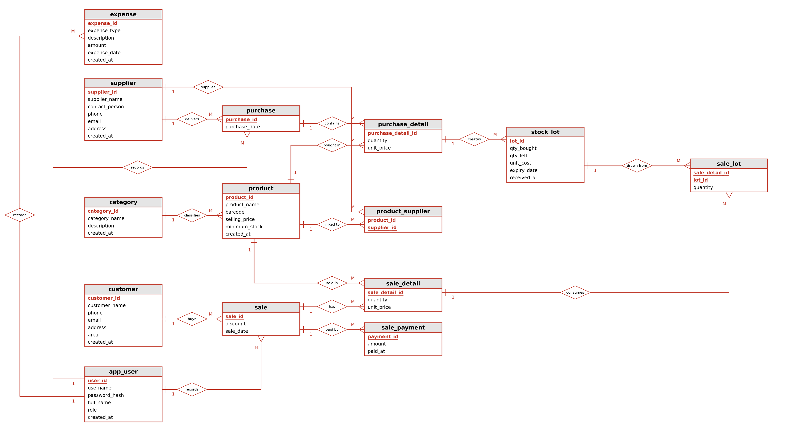

# 🛒 Sufian Store — Grocery Management System

A complete grocery-shop management system for a neighbourhood *mudir dokan* in Gollamari, Khulna.
It replaces paper ledgers, handwritten cash memos and "remembered" dues with one simple web app:
**products, batch-wise stock, purchases, sales, customer dues, expenses, staff accounts and profit reports.**

> Database Systems Project · 2026-II · **Group 05** · Instructor: **Aminul Islam**


---

## ✨ Features

| Area | What it does |
|---|---|
| **Billing (POS)** | One-screen sale, printable cash memo, discount, **partial payment** — the unpaid amount stays as *due* |
| **Batch stock (FEFO)** | Every purchase line becomes a stock lot with its own cost and expiry; sales use the **earliest-expiry lot first** |
| **Due collection** | Collect dues in instalments; overpayment is rejected; any counter staff can take a payment |
| **Purchases** | Record goods from suppliers; stock increases automatically; products are linked to their suppliers |
| **Alerts** | Low-stock and expiry (30-day) watch on the dashboard |
| **Profit** | Exact, COGS-based: `sales − cost of goods actually sold − expenses` |
| **Accountability** | Every sale, purchase and expense stores **which user entered it** |
| **Staff & Access** | Owner/Manager hire, edit, deactivate accounts; full audit log |
| **Security** | bcrypt passwords, PDO prepared statements, input validation, login lock, approval-based password change |
| **Reports** | Sales, Purchases, Profit, Top-Selling, Low-Stock & Expiry, Supplier Summary, Staff Activity |

## 👥 Roles

| Role | Login (seed) | Can access |
|---|---|---|
| **Owner** | `admin` / `admin123` | Everything, including Expenses and Staff & Access |
| **Manager** | `manager` / `manager123` | Everything except Expenses; can hire and manage **Cashier** accounts only |
| **Cashier** | `cashier` / `cashier123` | Cashier Dashboard, New Sale, Customers and a limited Reports view. **Never** sees profit, purchase cost, expenses or suppliers |

You only type a username and password — the backend finds the role itself.
Typing a restricted page URL sends you back to your home page, and cost fields are stripped on the server for the cashier role.

> ⚠️ These are demo passwords. Change them before using the system for real.

## 🧰 Tech stack

- **Frontend:** HTML, CSS, vanilla JavaScript (no framework, no build step)
- **Backend:** PHP 7.4+ (PDO, sessions) — plain JSON APIs in `api/`
- **Database:** MySQL 5.7+ / 8.x (or MariaDB)
- **Server:** PHP built-in server or XAMPP

## 🚀 Getting started

### 1. Set up the database

1. Start MySQL (XAMPP Control Panel → MySQL → **Start**).
2. Import [`database/database.sql`](database/database.sql) — it creates the database, all tables, the view and the sample data:
   - **phpMyAdmin:** create database `gms_db` → **Import** → choose `database/database.sql` → **Go**
   - **Command line:**
     ```bash
     mysql -u root -p < database/database.sql
     ```

If your MySQL uses a different host/user/password, set these environment variables before starting PHP
(defaults in brackets): `DB_HOST` (`127.0.0.1`), `DB_NAME` (`gms_db`), `DB_USER` (`root`), `DB_PASS` (empty).

### 2. Run the project

The `api/*.php` endpoints need PHP, so opening `index.html` directly (`file://`) will **not** work.

```bash
cd Grocery_Management_System
php -S localhost:8000
```

Open **http://localhost:8000** and sign in with one of the accounts above.

**Using XAMPP instead?** Copy the folder to `htdocs/`, start Apache + MySQL, and visit `http://localhost/<folder-name>`.

### 3. (Optional) Email for password-reset codes

Reset codes are sent through `config/mail.php` (plain SMTP, no Composer needed).

1. Copy `config/mail.local.example.php` to `config/mail.local.php` (git-ignored — never commit it).
2. Turn on 2-Step Verification in your Google account and create an **App password**.
3. Put your Gmail address and the 16-character app password in `config/mail.local.php`.

Without this file nothing is emailed: the code is written to `storage/mail-outbox.log`, so the whole flow can still be tested on a local PC.
Environment variables `MAIL_HOST`, `MAIL_PORT`, `MAIL_SECURE`, `MAIL_USER`, `MAIL_PASS`, `MAIL_FROM_NAME` override the file.

## 🗄️ Database design

The database has **14 core tables** (shown in the ER diagram), **4 supporting tables** for account security, and one read-only view.



| Group | Tables |
|---|---|
| **Master data** | `app_user`, `category`, `supplier`, `customer`, `product`, `product_supplier` |
| **Purchasing & stock** | `purchase`, `purchase_detail`, `stock_lot` |
| **Sales** | `sale`, `sale_detail`, `sale_lot`, `sale_payment` |
| **Finance** | `expense` |
| **Supporting (not in ER)** | `staff_log`, `login_attempt`, `password_request`, `password_code` |
| **View** | `v_product_live` — live stock, average cost and earliest expiry per product |

**Design principles**

- **Store only independent facts.** Bill totals, paid amount, due, stock, average cost and profit are *derived at read time* and never stored, so they can never go out of date. The schema is in 3NF.
- **Real batches.** Each purchase line creates one `stock_lot` (own cost + expiry). Each sale consumes lots oldest-expiry first and records it in `sale_lot` — that gives exact cost of goods sold and a full audit trail.
- **Who did it.** `sale`, `purchase` and `expense` each have a `user_id` (`app_user` 1 : M). It always comes from the login session on the server, never from a form field. Users with history are **deactivated, not deleted**.
- **Payments are rows.** The first cash taken at billing is also a `sale_payment` row, so `paid = SUM(amount)` and `due = bill − paid`.

Full analysis, questionnaire, ER diagram, schema, queries and UI design are in
[`documentation/GMS_Requirement_Analysis_and_Design.docx`](documentation/GMS_Requirement_Analysis_and_Design.docx).

## ⚙️ How it works

- `js/store.js` is the **API client**. Pages call `await GMS.ready`, then e.g. `await GMS.product.all()` or `await GMS.sale.add(...)`.
- **Purchase** (`POST api/purchases.php`) — inserts the bill and one stock lot per line, and auto-links the supplier to each product.
- **Sale** (`POST api/sales.php`) — checks live lot stock (oversell → HTTP `409`), inserts the bill, consumes lots FEFO, records `sale_lot` rows and the first payment — all inside **one MySQL transaction**.
- **Due collection** (`POST api/sale_payments.php`) — adds a payment; rejects anything above the remaining due.
- **Dashboard** (`GET api/dashboard.php`) — stats, low-stock/expiry watch, top sellers and recent sales, computed in SQL.
- **Deletes respect foreign keys** — e.g. a product used in a bill, or a supplier with purchases, cannot be deleted (HTTP `409` with a clear message).

### Validation & security

Every endpoint validates input in PHP, and the UI mirrors the same rules instantly in JavaScript.

| Input | Rule |
|---|---|
| Names | 2+ characters, letters/digits and `. , ' - ( ) & / % +`; HTML tags rejected |
| Mobile | Bangladesh mobile: exactly 11 digits, `01[3-9]…` |
| Email | Valid format when given |
| Money | Finite number, 2 decimals, never negative |
| Quantity | Whole number ≥ 1 |
| Dates | Real calendar dates only |
| IDs | Positive integers that must exist (else HTTP `422`) |

Also: PDO prepared statements everywhere, bcrypt (`password_verify`), HTML/control characters stripped, 1 MB request-body cap.

### Staff, login lock and passwords

- **Staff & Access** (`api/users.php`) — the Owner can hire Cashiers and Managers, edit, deactivate, change roles, and delete accounts with no history. A Manager can only hire and edit/deactivate **Cashiers**. Nobody can delete or deactivate themselves, or remove the last active Owner. Every action is saved in `staff_log`.
- **Login lock** — 5 wrong passwords for one username within 15 minutes locks that login (HTTP `429`). It lifts after 15 minutes, or an Owner/Manager presses **Unlock**. Stuck as the only Owner? Run `DELETE FROM login_attempt WHERE username = 'admin';` in phpMyAdmin.
- **Password change & reset** (`api/password.php`) — change it from **My Account** (current password required) or use **Forgot password?** (6-digit code by email, valid 10 minutes, 5 tries, single use). Approval rules:

  | Who | Who approves |
  |---|---|
  | Owner | Nobody — applied immediately |
  | Manager | The Owner |
  | Cashier | The Manager or the Owner |

  Until a request is approved, the *current* password keeps working. Pending requests appear on **Staff & Access → Password approvals**.

## 📄 Pages

| Page | Purpose |
|---|---|
| `index.html` | Login |
| `dashboard.html` | Summary, low-stock/expiry watch, top sellers, recent sales |
| `cashier.html` | Cashier Dashboard — today's bills, sales, cash and due + quick actions |
| `sales.html` | New sale / POS, printable cash memo, due collection |
| `products.html` | Product catalogue with stock and expiry status |
| `categories.html` | Product categories |
| `suppliers.html` | Suppliers and their purchase counts |
| `customers.html` | Customers (walk-ins need no record) |
| `purchases.html` | Record goods bought from a supplier |
| `expenses.html` | Rent, electricity, salary, transport, etc. *(Owner only)* |
| `staff.html` | Staff & Access — accounts, password approvals, audit log |
| `account.html` | My Account — change your own password |
| `reports.html` | All reports (Cashier sees a limited set) |

## 📁 Project structure

```text
Grocery_Management_System/
├── index.html  dashboard.html  cashier.html  sales.html  products.html
├── categories.html  suppliers.html  customers.html  purchases.html
├── expenses.html  staff.html  account.html  reports.html
├── api/
│   ├── auth.php  password.php  users.php          # login, passwords, staff
│   ├── products.php  categories.php  suppliers.php  customers.php
│   ├── purchases.php  sales.php  sale_payments.php  lots.php
│   ├── expenses.php  dashboard.php
├── config/
│   ├── db.php                  # PDO connection, validators, row mappers
│   ├── mail.php                # SMTP sender (no Composer)
│   └── mail.local.example.php  # copy to mail.local.php
├── database/
│   └── database.sql            # schema + view + sample data
├── documentation/
│   ├── gms_er_diagram.png
│   └── GMS_Requirement_Analysis_and_Design.docx
├── css/                        # shared design system + one file per page
└── js/                         # store.js (API client), app.js, one file per page
```

## 🎨 Design notes

A "digital ledger" look drawn from the shop's own paper forms: ruled tables, receipt-style totals on the sale screen,
and left accent bars for stock/expiry status. Deep green with a turmeric accent, Space Grotesk headings and Inter body text.

## 🧑‍💻 Team

| # | Name | Student ID |
|---|---|---|
| 1 | Togor | 240207 |
| 2 | Md. Abu Mursalin | 240212 |

**Course:** Database Systems, 2026-II · **Group:** 05 · **Instructor:** Aminul Islam
